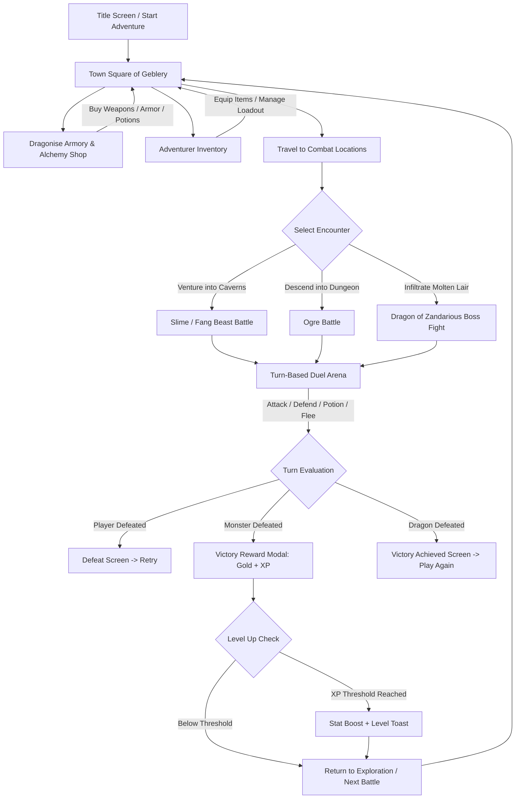

# DragonSlayer RPG 🐉

A modernized, dark fantasy turn-based RPG web application built with **modular Vanilla JavaScript (ES modules)**, **HTML5**, and **CSS3**.

---

## 📖 Overview & Story
**DragonSlayer RPG** immerses players into the besieged realm of **Geblery**. Monolithic terrors and subterranean beasts stalk beyond the ancient city gates, while the mythical **Dragon of Zandarious** slumbers deep within its molten cavern lair.

As an adventurer, you explore distinct territories, equip armor and forged blades from the town armory, craft elixirs, take on infestation bounties, and battle monsters in turn-based tactical combat to liberate the kingdom.

---

## 🛠️ Technologies Used
- **HTML5:** Semantic architecture with dedicated duel stage canvases, SVG sprite nodes, modular HUD layout, and modal overlays.
- **Vanilla CSS3:** Custom dark-fantasy design system utilizing glassmorphism, dynamic radial/linear gradients, CSS keyframe animations, glowing filigree accents, and custom CSS custom properties (`--gold-bright`, `--crimson`, `--teal-glow`, etc.). No external CSS frameworks.
- **Modular JavaScript (ES6+ Modules):** Clean separation of concerns with native `import`/`export` across specialized modules:
  - `game.js` — Core game controller and orchestration loop.
  - `js/state.js` — Central reactive state container, progression math, level-up calculations, and `localStorage` persistence.
  - `js/combat.js` — Turn-based combat engine handling damage variance, defense mitigations, hit/crit/dodge logic, and boss mechanics.
  - `js/ui.js` — DOM controller for HUD plates, combat action buttons, floating damage/heal text, modal drawers, and notifications.
  - `js/shop.js` — Armory and potion vendor mechanics with transaction validation and dynamic inventory binding.
  - `js/audio.js` — Procedural Web Audio API sound synthesizers (swords, shields, potions, crits, level-ups, boss roars) with zero external audio assets.
  - `js/sprites.js` — Dynamic, scalable vector SVG sprites for the Player Knight, Slime, Fang Beast, Ogre, and Dragon.
- **Google Fonts:** `Cinzel`, `Outfit`, and `JetBrains Mono` for thematic fantasy headings and readable stat readouts.
- **Node.js Native Test Runner:** Lightweight unit testing with `node --test` for verifying combat calculations and level scaling.

---

## 🧠 Architecture & Key Concepts

### 1. Unidirectional State Management (`js/state.js`)
All game data (player HP, max HP, XP, level, gold, current weapon, current armor, potions catalog, location, combat logs, and quest states) lives in a centralized reactive state store. State changes trigger UI re-renders and auto-save checkpoints to `localStorage` (`dragonslayer_save_v1`), allowing players to resume adventures seamlessly.

### 2. Event-Driven Combat Engine (`js/combat.js`)
Combat calculations operate deterministically through the `CombatEngine` class:
- **Formulas:** Damage is determined by weapon damage + stat scaling with random variance, mitigated by armor defense percentage and shield active block states.
- **Turn Loop:** Player actions (`ATTACK`, `DEFEND`, `USE POTION`, `FLEE`) calculate outcomes, apply status changes, trigger audio synthesizer frequencies, and emit structured combat feedback objects to the UI.
- **Boss Mechanics:** The Dragon features multi-turn charged infernal firebreath attacks requiring strategic shield timing.

### 3. Floating Combat Text & Visual Juice
Damage numbers, critical strikes, and healing are projected directly into the arena view via dynamic CSS floating keyframes (`@keyframes floatDamageUp`), providing immediate visual clarity above battlers.

### 4. Zero-Asset Audio Synthesis (`js/audio.js`)
Sound effects are synthesized in real-time using native browser `AudioContext` oscillators (sine, square, sawtooth) and gain envelopes, eliminating external audio download latencies.

---

## 🔄 Overall Workflow & Game Loop



1. **Initialization:** The player begins on the Start Screen. Clicking **"START ADVENTURE"** loads the saved state or bootstraps a fresh hero.
2. **Town Hub:** The player can inspect stats in the top HUD, access the **Store** to buy gear, open the **Inventory**, or open the **Chronicles & Logs** drawer.
3. **Exploration & Combat:** Venturing into hostile zones enters the **Duel Stage** with animated battler cards and dynamic atmospheric backdrops.
4. **Action Selection:** The player chooses from 4 quick actions or presses hotkeys `1`, `2`, `3`, or `4`.
5. **Turn Execution:** Damage numbers float above characters, attack animations play, sound effects fire, and battle logs update.
6. **Victory & Progression:** Defeating an adversary displays the **Combat Reward Popup** with gold and XP. Leveling up increases max health and unlocks higher combat potential.
7. **Endgame:** Defeating the Dragon of Zandarious triggers the glorious **Victory Modal**.

---

## 🎮 Features Implemented

### 1. Visual Design & Aesthetics
- **Dark Fantasy Theme:** Rich deep navy and charcoal palette accented with luminous gold and crimson borders.
- **Typography:** `Cinzel` for royal titles, `Outfit` for clean stats, and `JetBrains Mono` for damage metrics.
- **Dynamic Location Backdrops:** Atmospheric ambient lighting and backdrops for Town Square, Summersville Store, Caverns, and Dragon's Lair.
- **Vector Monster Art:** Custom animated SVG sprites for Slime, Fang Beast, Ogre, and the Dragon.
- **Top HUD Bar:** Fixed header with level badge, animated HP/XP progress bars, gold counter, and equipped weapon/armor slots.

### 2. Combat Feedback & Animations
- **Visual Effects:** Screen shake on heavy impacts, red flash damage indicator on monster sprites, and death fade-outs.
- **Floating Numbers:** Floating damage and healing indicators with critical hit styling.
- **Combat Log Drawer:** Slide-out right-hand panel toggled via the `LOG` button in the HUD.
- **Sound Effects (Web Audio API Synthesizer):** Sword hit, critical hit, shield block, coin collection, potion drinking, level up, boss roar, and game over—plus mute toggle button (🔊 / 🔇).
- **Combat Reward Modal:** Pop-up displaying gold and XP earned after defeating an opponent.
- **Potion Selection Dialog:** Quick selector modal allowing the player to choose which potion to quaff during battle.

### 3. Gameplay Depth & Mechanics
- **Leveling & Stat Growth:** Dynamic XP thresholds, Max HP scaling, base attack and defense bonuses, and crit/dodge scaling upon level up.
- **Combat Variety:** Critical hit rate, dodge/miss calculations, shield defending (reducing damage by ~60%), and fleeing.
- **Dragon Boss Abilities:** Multi-turn charged attack with infernal fire breath warning.
- **Shop & Inventory:** Full store selling potions, tiered weapons, and armor that dynamically grey out if gold is insufficient.
- **Random Events & Quests:** Active quests (e.g., "Clear the Infestation") with gold/XP rewards.

---

## 🚀 How to Run Locally

Because the project uses standard **ES Modules** (`import` / `export`), it needs to be served via any local HTTP server (browsers block local file imports over `file://` for CORS security).

### Option 1: Python (Recommended - No install required)
Run this command from inside the `DragonSlayer-RPG` directory:
```bash
python3 -m http.server 8080
```
Then open your browser to: 👉 **[http://localhost:8080](http://localhost:8080/)**

---

### Option 2: Node.js (npx serve / npm start)
```bash
npm start
```
or:
```bash
npx -y serve .
```

---

### Option 3: VS Code / IDE Live Server
If you use VS Code or PyCharm / WebStorm:
- Right-click `index.html` and select **"Open with Live Server"** or click the Browser Preview icon.

---

## 🧪 Running Unit Tests
To run the automated combat and leveling tests:
```bash
npm test
```
All tests run with Node's native test runner (`node --test`).
